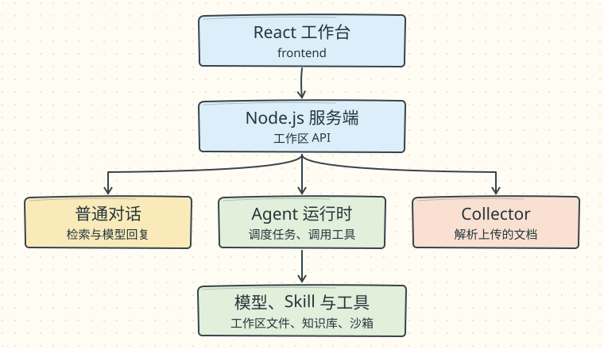
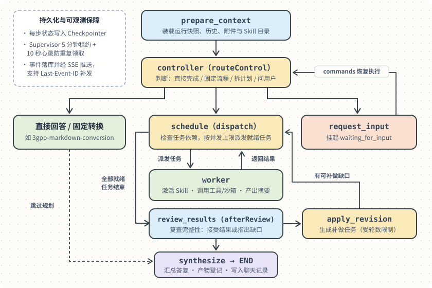

# CoreGenie 软件架构与 Agent 运行机制

在工作区里点一次「发送」，可能只是向模型提问，也可能启动一个需要查资料、运行工具、生成文件的 Agent 任务。两者共用工作台和服务端，处理一次请求的方式有所不同。本文以「把一份 3GPP 提案转成 Markdown」为例，说明从用户提交到文件出现在对话里，各部分分别做什么。

## 工作台由哪些部分组成

React 工作台负责收集输入、显示消息和文件。Node.js 服务端识别工作区和会话，再把请求交给对应模块。普通聊天通过 `stream-chat` 接口逐段返回回答；Agent 接口先创建一条有独立编号的运行记录，再通过事件报告进度。前端可以用这个编号重新连接正在执行的任务。[聊天接口](../../server/endpoints/chat.js) · [Agent 接口](../../server/endpoints/agentRuns.js)

Collector 是单独运行的文档采集和解析服务。Agent 也有自己的文件工具，例如提案转换助手通过沙箱运行专用脚本。查文档问题时，先确认请求走的是通用解析还是专用转换。服务端通过 Prisma 保存工作区、会话和任务等记录；文档文件保存在文件存储中，知识检索还会使用向量库。[Collector 入口](../../collector/index.js) · [数据模型](../../server/prisma/schema.prisma) · [提案转换工具](../../server/tools/threeGpp.js)

## 一次 Agent 请求怎样执行

1. **创建任务。** 工作台向 `POST /api/workspace/:slug/agent-runs` 提交提示词、附件和助手标识。在线程里使用带 `thread/:threadSlug` 的接口。服务端解析助手配置，保存本次运行的快照，创建 `AgentRun`，记录 `run.queued` 事件并加入队列。客户端收到 HTTP 202 和运行编号。如果同一会话已有活动任务，接口返回 409 和已有的运行记录。[提交逻辑](../../server/agent-system/service.js)
2. **领取并执行。** Supervisor 从队列取出任务，在数据库中登记限时有效的执行权，并在执行期间续期。Executor 用快照中的 `runtimeKey` 和版本找到对应实现，调用 `executeSegment`。因此同一个工作区可以有行为不同的助手。[队列与执行权](../../server/agent-system/supervisor.js) · [执行器](../../server/agent-system/executor.js) · [运行时注册表](../../server/agent-system/runtimes/registry.js)
3. **显示进度。** 客户端订阅 `GET /api/agent-runs/:runId/events`。服务端通过 SSE（服务器发送事件）推送文本、工具活动和状态变化。断线后，客户端可带上最后收到的事件编号，服务端从数据库补发后续事件，再接上实时推送。[事件接口](../../server/endpoints/agentRuns.js)
4. **交付结果。** 执行器整理答复、资料来源和已登记的产物，写入聊天记录。工具执行中途失败时，服务端也会尝试保存已经生成的内容和具体原因；工具是否成功、文件是否登记、回复是否写入是三个可以分别检查的环节。[结果保存](../../server/agent-system/executor.js) · [产物登记](../../server/agent-system/artifactRegistration.js)

**页面断线和服务重启是两件事。** 页面重连主要靠事件记录。服务重启后，Supervisor 查找可以重新领取的任务，处理上次中断的工具调用，再由运行时利用检查点恢复执行。排查恢复问题时，还要核对工具写出的文件及其登记记录；检查点记录的是执行进度。[任务恢复](../../server/agent-system/supervisor.js) · [检查点存储](../../server/agent-system/checkpointer.js)

## 谁决定下一步做什么

`runtimeKey` 决定助手采用哪种运行方式。`default-react` 让模型在同一段会话里选择工具、读取结果、继续回答；这里的 ReAct 是模型推理与工具调用循环。`governed-agent` 支持直接回答、请求补充信息，以及拆分和检查任务。注册表还提供实验性的 `evidence-research`，用于规划研究、收集资料和检查遗漏。读某个助手时应先看其 YAML 中的实际绑定。[助手定义](../../agent-config/agents) · [运行方式与实现的对应关系](../../server/agent-system/runtimes/registry.js)

在分步流程中，模型可以提出「先读材料，再做对比」的计划。CoreGenie 检查哪些任务的前置条件已满足，按并发上限分派给执行步骤。结果回来后，复查步骤可以接受结果、指出缺口，或在轮数限制内要求补做。图中间这条路径适用于需要拆分的任务；能直接完成的请求从左侧结束。[流程节点与分支](../../server/agent-system/runtimes/governed.js)

| 谁 | 具体职责 |
| --- | --- |
| 大语言模型 | 根据当前提示词、资料和可见工具提出回答、工具调用或任务计划。在复查步骤中判断现有结果能否回答问题。 |
| LangChain | 在使用通用 Agent 循环时，把模型、系统提示词、工具和中间件组装起来，将工具结果送回模型继续处理。[组装入口](../../server/agent-system/graph.js) |
| LangGraph | 运行项目定义的流程节点和条件分支，通过检查点保存图的执行状态。[分步运行时](../../server/agent-system/runtimes/governed.js) |
| CoreGenie | 决定使用哪个模型和运行方式、提供哪些 Skill 和工具、何时执行固定流程，以及怎样保存任务、事件和文件。[运行时目录](../../server/agent-system) · [工具目录](../../server/tools) |

## 一个 Skill 怎样进入本次任务

**绑定、激活和执行是三个步骤。** 绑定决定候选范围，激活让本次任务取得完整说明，工具执行才会实际读文档、查资料或写文件。

- **绑定。** 全局助手的 YAML 声明它能使用的全局 Skill。服务端还会把当前工作区中有效且无名称冲突的 Skill 包加入候选目录。规划时模型先看到名称和简介。[Skill 目录生成](../../server/agent-skills/registry.js)
- **激活。** 普通规划任务中，模型可按需调用 `activate_skill` 并填写名称。CoreGenie 校验可用性，记录 Skill 名称、范围和版本，返回完整说明及文件清单。固定业务流程也可以在代码里直接指定要激活的 Skill。[激活工具](../../server/tools/skills.js)
- **执行。** Skill 可以附带参考材料或脚本。模型或固定流程调用当前可用的工具，由工具访问对应的工作区资源；激活动作本身只加载说明。[工具上下文](../../server/tools/context.js)

### 实例：转换一份提案

用户上传一份 DOCX 并要求转成 Markdown。转换助手绑定了 `3gpp-review` 和 `3gpp-doc2md`。当控制器能从请求和附件确定单一输入时，项目代码直接激活 `3gpp-review`，然后调用 `3gpp.convert-markdown`。多文件任务还有单独的 Skill 指令。[助手配置](../../agent-config/agents/3gpp-markdown.yaml) · [固定转换分支](../../server/agent-system/runtimes/governed.js)

工具定位上传文件；如果输入是可识别的单个 TDoc 编号，则从官方来源获取文档。随后它在沙箱里执行 Skill 包的转换脚本，检查转换摘要和压缩包，并登记可供下载的文件。回复中的 Markdown 路径、图片数、嵌入对象数和警告取自工具结果。遇到「内容转错」应查看脚本和转换摘要；遇到「文件已生成但页面没有下载项」则应沿着产物登记和最终消息往下查。[转换工具](../../server/tools/threeGpp.js) · [转换 Skill 包](../../agent-config/skills/3gpp-review)

## 开发时从哪里下手

| 想做什么 | 从哪里开始 |
| --- | --- |
| 调整某个助手的职责、工具或 Skill 绑定 | 找到对应的 [Agent YAML](../../agent-config/agents)。共享提示词和 Skill 的配置源在 [agent-config](../../agent-config/README.md)。种子 Agent 变更时同步更新种子版本和对应测试。 |
| 修改分析方法或文档转换规则 | 先看 [Skill 包](../../agent-config/skills) 的 `SKILL.md`，再顺着引用查参考材料和脚本。 |
| 新增一种能实际执行的操作 | 参考现有 [工具定义](../../server/tools/descriptor.js) 与 [工具注册入口](../../server/tools/index.js)，明确输入、执行结果和失败原因。 |
| 调整任务调度、完成条件或恢复行为 | 从 [分步运行时](../../server/agent-system/runtimes/governed.js) 或 [Supervisor](../../server/agent-system/supervisor.js) 入手，运行对应的 [Agent 测试](../../server/__tests__/agent-system)。 |
| 复现用户在工作台遇到的问题 | 记录运行编号，按事件顺序找到首次偏离预期的步骤。需要对比修改前后的真实表现时，可用 [Agent 评测](../../evals/agent/README.md) 经过与工作台相同的 Agent 运行时执行用例。 |
