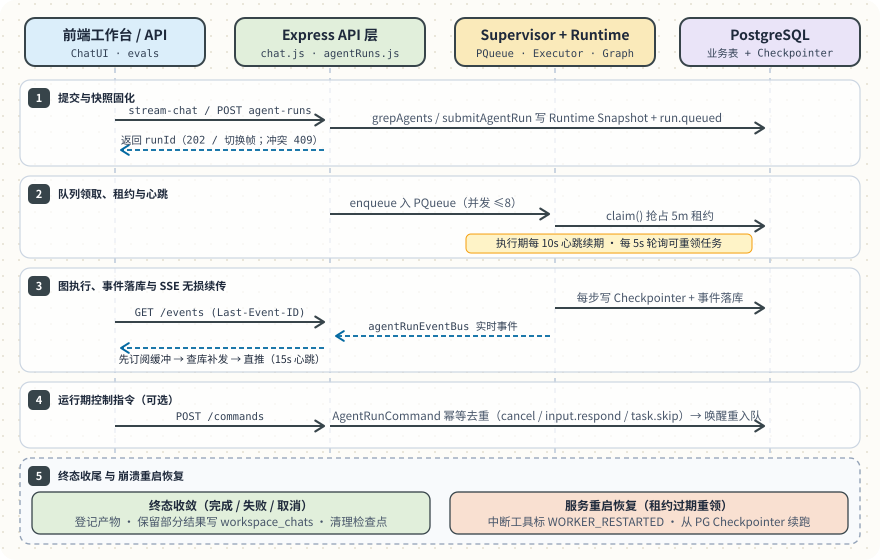
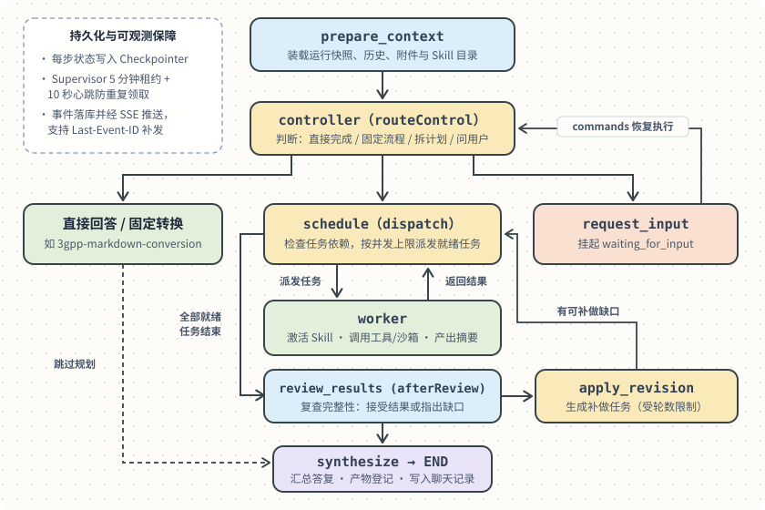

# Agent 运行时与任务调度

> **所属层级**：L2 专题 · 进程与执行视图 ｜ 返回 [架构总览](../architecture.md)
>
> **本文范围**：说明一次 Agent 任务从 HTTP 提交、队列调度、图执行、SSE 推送到故障恢复的完整运行机制，以及控制权在模型与框架之间的划分。配置/工具编写见 [配置体系、Skill、工具与沙箱](config-skills-sandbox.md)。

## 1. 入口路由与异步任务协议

CoreGenie 的 Web 工作台对话**几乎全部运行在异步 Agent 模式下**：前端发送消息时先统一请求 `POST /api/workspace/:slug[/thread/:threadSlug]/stream-chat`（[chat.js](../../../server/endpoints/chat.js)）处理 `/reset` 与斜杠命令展开，随即在 [grepAgents()](../../../server/utils/chats/agents.js) 中命中已选或默认内置 Agent，创建 `AgentRun` 并返回 `runId` 切换帧；前端收到后立刻改连持久化的 SSE 事件流与命令接口。

这样设计的目的是**把长耗时任务与浏览器 HTTP 连接解耦**（支持数分钟到数小时的执行、人工补充信息、刷新页面续连与服务重启恢复）。开发者 API 与 `evals/agent` 评测脚本则可直接调用 `POST .../agent-runs` 跳过握手：

| 接口 | 作用 | 关键行为 |
| --- | --- | --- |
| `POST /api/workspace/:slug[/thread/:threadSlug]/stream-chat` | Web 工作台统一发送入口 | 先展开斜杠命令 / 处理 `/reset`，随后由 `grepAgents()` 升级为 `AgentRun` 并返回 `run.id` 供前端切换 SSE |
| `POST /api/workspace/:slug[/thread/:threadSlug]/agent-runs` | 直接创建运行记录并入队（API / 评测直连） | 返回 **HTTP 202** 与 `runId`；若同一会话已有活动任务（`queued` / `running` / `waiting_for_input` / `waiting_for_approval`），返回 **HTTP 409** 及已有运行记录 |
| `GET /api/agent-runs/:runId/events` | 订阅实时事件流（SSE） | 支持 `Last-Event-ID` 或 `?after=<id>` 断点补发，每 15 秒发送心跳，终态自动关闭 |
| `GET /api/agent-runs/:runId/snapshot` | 拉取当前完整状态快照 | 返回 `run`、任务列表、证据、工具执行记录、事件摘要、产物及最新事件游标 `cursor`；支持 `?view=rail` 精简视图 |
| `POST /api/agent-runs/:runId/commands` | 向运行中的任务发控制指令 | 经 `AgentRunCommand` 持久化去重（幂等），支持 `run.cancel`、`input.respond`、`approval.respond`、`task.cancel`、`task.skip` |
| `GET /api/workspace/:slug[/thread/:threadSlug]/agent-runs/active` | 查询会话当前活动任务 | 页面刷新或切回会话时用于重新挂接 SSE |

入口实现见 [agentRuns.js](../../../server/endpoints/agentRuns.js) 与 [service.js](../../../server/agent-system/service.js)。

## 2. 一次任务的生命周期

### 2.1 提交与运行时快照

提交请求时，[submitAgentRun](../../../server/agent-system/service.js) 不会只存一个 `agentId`，而是先生成一份 **Runtime Snapshot**（[runtimeSnapshot.js](../../../server/agent-system/runtimeSnapshot.js)），把当前解析出的 Agent 提示词、`runtimeKey`、`runtimeConfig`、策略限制和全局 Skill 版本固定到 `agent_runs` 记录中。随后写入 `run.queued` 事件并交由调度器入队。

这样做的直接收益是：**任务执行或重启恢复期间，即便管理员修改了全局 Agent 或 Skill 配置，已运行任务仍按原版本继续，不会中途漂移。**

### 2.2 调度、租约与并发控制

[AgentRunSupervisor](../../../server/agent-system/supervisor.js) 随主服务启动，在单进程内维护一个 `PQueue`（默认同时运行 8 个任务，可通过 `AGENT_RUN_CONCURRENCY` 调整）：

1. **领取与租约（Lease）**：Worker 执行前通过 `AgentRun.claim` 在数据库中原子登记 `owner`（`hostname:pid:uuid`）和 **5 分钟有效租约**。
2. **心跳续期**：执行期间每 **10 秒** 续期一次租约；即便某些同步预处理短暂阻塞事件循环，5 分钟窗口也避免被误判为失联而重复执行。
3. **兜底轮询**：Supervisor 每 **5 秒** 扫描数据库中可重新领取的任务（含排队未领或租约已过期的任务），避免内存队列遗漏。
4. **运行预算**：在启用限制的环境下由 `AbortController` 管控总时长（默认 4 小时，上限 24 小时）；当前工作台默认可通过系统设置放开总时长与模型调用次数上限，但单次工具与沙箱资源限制始终生效（详见 [执行上限](../../execution-limits.md)）。

### 2.3 事件流与断线无损续传

SSE 推送最常见的坑是“查历史事件”和“订阅实时事件”之间的竞态丢包或重复。[streamEvents](../../../server/endpoints/agentRuns.js) 用三步规避了这个问题：

1. **先订阅**内存事件总线 `agentRunEventBus`（此时置 `replaying = true`，新到达的事件先暂存到 `pending` 数组）。
2. **再查库**回放 `AgentRunEvent.after(runId, cursor)`，逐条发送并推进 `cursor`。
3. **切换直推**：置 `replaying = false`，冲刷 `pending` 中 `id > cursor` 的事件，之后实时事件直接写入响应流。

前端断线重连只需带上最后收到的事件 ID，即可无缝衔接。

### 2.4 产物登记、终态与部分结果保留

任务结束时，[executor.js](../../../server/agent-system/executor.js) 将答复正文、引用来源与已登记的产物写入 `workspace_chats`。如果任务在中途失败、超时或被取消：

- 服务端调用 `persistFailedAgentRun` 尽量保留已经生成的中间回复和具体错误原因（`run.partial` / `run.failed` / `run.cancelled`），并补发消息事件使前端能关联到聊天记录 ID。
- 所有未完成的工具调用记录（`agent_tool_executions`）与子任务（`agent_run_tasks`）统一收敛为终态，避免界面一直停在“执行中”。
- 终态后清理对应的 LangGraph 检查点线程。

## 3. 三种运行时与 `governed-agent` 状态机

Executor 根据运行快照中的 `runtimeKey` 和版本，从 [运行时注册表](../../../server/agent-system/runtimes/registry.js) 加载对应实现：

| `runtimeKey` | 定位 | 角色模型支持 | 适用场景 |
| --- | --- | --- | --- |
| `governed-agent`（默认） | 分步编排与检查（Orchestrated） | `controller`、`worker`、`reviewer`、`vision` | 复杂多步任务、需生成文件产物或需要人工补充输入的场景 |
| `default-react` | 连续单会话 ReAct 循环 | `vision`（可选） | 轻量连续推理与工具调用；不拆分子任务计划 |
| `evidence-research`（实验） | 多分支并行研究 | `planner`、`worker`、`reviewer` | 规划研究子问题、并行检索资料并检查遗漏 |

默认运行时 `governed-agent` 使用 LangGraph 构建显式状态图（[governed.js](../../../server/agent-system/runtimes/governed.js)）：

图节点与关键分支如下：

1. `prepare_context` → `controller`：装载会话历史、附件元数据、可用 Skill 目录与工具集。
2. `controller`（条件路由 `routeControl`）：
   - **直接完成 / 固定流程**：简单问答直接回复；命中固定业务流程（如单文件 `3gpp-markdown-conversion`）时跳过自由规划，直接进入确定性分支。
   - **请求补充输入（`request_input`）**：挂起任务并将状态置为 `waiting_for_input`；用户经 `commands` 提交回答后重新入队，从检查点回到 `controller`。
   - **制定计划（`schedule`）**：产出带依赖关系和写意图的任务列表，写入 `agent_run_tasks`。
3. `schedule` ↔ `worker`：检查前置依赖已满足的就绪任务，按并发上限分派执行；子任务结束后回到 `schedule` 推进下一批。
4. `review_results`（条件路由 `afterReview`）：复查任务结果是否完整。若有可补做的缺口且未达轮数上限，经 `apply_revision` 回到 `schedule`；否则进入 `synthesize` 汇总答复并结束。

## 4. 控制权分工：谁决定下一步做什么

排查 Agent 行为异常时，先分清问题是模型决策、编排逻辑还是业务约束：

| 层次 | 具体职责 | 主要代码入口 |
| --- | --- | --- |
| **大语言模型** | 根据上下文、Skill 说明和工具 Schema 产出回答、工具调用参数或任务计划；在复查节点判断材料是否充分 | 由 `modelRoles` 与系统模型路由决定 |
| **LangChain** | 在 ReAct 或 Worker 内部组装模型、系统提示词、工具与中间件（如上下文压缩、日志），回传工具结果 | [graph.js](../../../server/agent-system/graph.js) · [modelMiddleware.js](../../../server/agent-system/modelMiddleware.js) |
| **LangGraph** | 执行图节点与条件边，在每个步骤通过 Checkpointer 持久化图状态，支撑中断（interrupt）与恢复 | [governed.js](../../../server/agent-system/runtimes/governed.js) · [checkpointer.js](../../../server/agent-system/checkpointer.js) |
| **CoreGenie 服务端** | 管任务队列与租约、固定业务捷径、Skill 校验、工具幂等/审计、产物登记、并发与执行上限、SSE 推送 | [server/agent-system/](../../../server/agent-system) · [server/tools/](../../../server/tools) |

## 5. 页面断线 vs 服务重启恢复

两者的恢复机制完全不同，排障时不要混淆：

- **页面刷新 / 网络断线**：后端任务继续执行，不受影响。前端重新打开会话后，通过 `GET .../agent-runs/active` 拿回 `runId`，先拉 `/snapshot` 再用 `cursor` 订阅 `/events` 即可接上实时进度。
- **服务端进程重启**：
  1. 新进程启动 `AgentRunSupervisor`，先将已终态任务遗留的活动工具记录收敛。
  2. 通过 `AgentRun.reclaimable()` 捞出中断时仍为 `running` 或 `queued` 且租约过期的任务。
  3. 对上次中断时处于 `running` 的任务，先把未结束的工具调用标为 `WORKER_RESTARTED`，把运行状态重置为 `queued` 并标记 `configuration.recover = true`。
  4. Runtime 从 [checkpointer.js](../../../server/agent-system/checkpointer.js) 读取上次保存的图状态继续执行（通过 `PostgresSaver` 持久化在 PostgreSQL 的 `langgraph` 与 `langgraph_custom` Schema 中）。

> **排查恢复问题的检查清单**：检查点只记录图执行进度，不回滚文件系统。若恢复后结果异常，需同时核对三处：`agent_run_events`（事件时间线）、`agent_tool_executions`（哪些工具已实际执行或中断）、工作区磁盘文件与 `agent_run_artifacts`。

---

**下一篇**：[配置体系、Skill、工具与沙箱 →](config-skills-sandbox.md)
