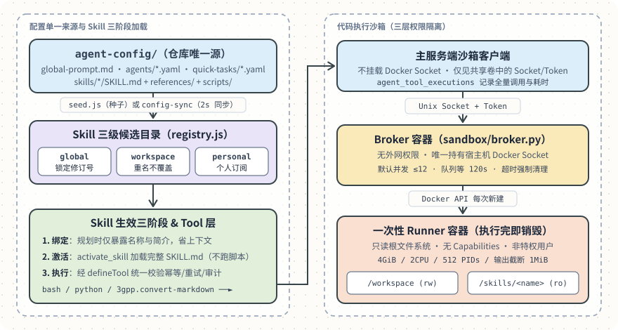

# 配置体系、Skill、工具与沙箱

> **所属层级**：L2 专题 · 开发与扩展视图 ｜ 返回 [架构总览](../architecture.md)
>
> **本文范围**：面向需要新增或调整 Agent、Skill、Tool 与脚本能力的开发者，说明配置如何从仓库进入运行时、能力如何分层加载，以及代码执行沙箱的隔离架构。

## 1. 配置单一来源：`agent-config/` 与双运行模式

CoreGenie 把所有共享提示词、预置 Agent、Skill 包、快捷任务表单和内置斜杠命令集中维护在仓库根目录的 [agent-config/](../../../agent-config/README.md)，服务端代码不再另存提示词副本：

```text
agent-config/
├── global-prompt.md          # 全局系统提示词
├── agents/<key>.yaml         # Agent 定义（runtimeKey、tools、skills、quickTasks、enabled、showInRoster）
├── quick-tasks/<key>.yaml    # 可复用任务向导表单（生成草稿，不自动发送）
├── skills/<key>/             # Skill 包（SKILL.md + references/ + scripts/）
└── commands/*.json           # 内置斜杠命令预设
```

配置文件进入数据库有**两种互斥模式**，由环境变量 `AGENT_CONFIG_SYNC_ENABLED` 决定：

| 模式 | 适用环境 | 生效机制 | 注意事项 |
| --- | --- | --- | --- |
| **种子初始化模式（默认）** | 标准镜像部署、无需在线双向同步的环境 | [seed.js](../../../server/agent-skills/seed.js) 按统一版本号（当前 `agent_config_seed_v19`）在单事务内一次性导入 Skill → QuickTask → Agent | 修改预置配置后必须**递增种子版本**并同步测试；后续在 Web 后台的修改重启后保留 |
| **仓库双向同步模式** | 需要代码仓与后台编辑器联动迭代的环境 | [config-sync](../../../server/config-sync) 单进程每 2 秒扫描挂载目录，并与 Web 保存操作互斥串行；按上次同步哈希检测单边变更或双边冲突 | 启用时自动跳过内置种子更新；双边冲突需在后台「仓库配置同步 → 比较版本」人工解决；删除文件不会删除数据库记录，退役请设 `enabled: false` 或 `archived: true` |

> **关键设计**：Agent YAML 中引用 Skill 和 QuickTask 均使用**稳定的目录/文件 key**（而非数据库自增 ID），确保配置跨环境可移植；另可通过 `enabled: true` + `showInRoster: false` 定义仅供其他 Agent 通过 `agent.call` 委派的内部专职 Agent。详见 [仓库配置同步说明](../../agent-config-sync.md)。

## 2. Skill 的三级来源与三阶段生效



### 2.1 三级作用域与优先级

[server/agent-skills/registry.js](../../../server/agent-skills/registry.js) 在任务开始前为当前 Agent 和工作区拼装候选 Skill 列表，来自三个层级：

1. **全局 Skill（`global`）**：由 Agent YAML 的 `skills` 字段显式绑定，存有不可变修订快照（`agent_skill_revisions`）。
2. **工作区私有 Skill（`workspace`）**：位于工作区目录 `/workspace/.agent/skills/<name>`；若与全局 Skill 重名，工作区版本会被标记为冲突无效，不覆盖全局定义。
3. **个人 Skill（`personal`）**：用户创建或订阅的私有 Skill，运行时自动分配不冲突的 `personal-<id>` 名称。

### 2.2 绑定 → 激活 → 执行

为避免把所有领域规则一次性塞爆模型上下文，Skill 采用延迟加载机制：

1. **绑定（目录可见）**：任务初始化时，模型只看到可用 Skill 的**名称与简介**。
2. **激活（加载说明）**：模型按需调用 `activate_skill`（或固定流程由代码直接激活）。[tools/skills.js](../../../server/tools/skills.js) 校验可见性后，记录本次任务激活的 Skill 名称、作用域与修订号，返回完整的 `SKILL.md` 正文与附带文件清单。**激活动作本身不执行任何脚本。**
3. **执行（按需读资源与跑脚本）**：模型或固定流程通过 `read_skill_resource` 读取参考文档，或通过 `bash` / `python` / 专用工具调用 Skill 包内脚本。

> **关于版本锁定**：新创建的 Agent 任务会锁定所绑定全局 Skill 的修订号；重启恢复时加载同一修订，避免任务中途因配置更新而前后规则不一致。

## 3. 统一工具层：`defineTool` 与执行约束

所有内置工具都在 [server/tools/index.js](../../../server/tools/index.js) 注册，并通过 [defineTool](../../../server/tools/descriptor.js) 声明结构化元数据，再包装为 LangChain Tool：

- **工具分类**：文件读写（`filesystem.*`）、沙箱脚本（`bash`、`python`）、知识库检索与发布（`knowledge.*`、全局知识库工具）、记忆（`memory.*`）、联网搜索/抓取（`web.*`）、3GPP 专用工具（`3gpp.resolve-meeting`、`3gpp.download`、`3gpp.convert-markdown`）、Skill 工具（`skill.*`）、视觉看图（`vision.inspect`）、人工输入（`ask_user`）与定时任务等。
- **元数据约束**：每个工具声明 `effect`（`read` / `write` / `destructive`）、`idempotency`（`safe` / `keyed` / `none`）、`retry`（读工具默认最多重试 2 次，写工具默认 1 次）、`maxResultBytes`（默认 32 KiB 截断防上下文膨胀）、`concurrencyKey` 与 `failureFamily`（同类失败熔断上限）。
- **审计与幂等键**：每次调用按 `sha256(toolId + 规范化参数)` 计算 `operationKey`，全量记录到 `agent_tool_executions` 表（含入参、状态、结果摘要、错误码和耗时），既是前端时间线的数据源，也是产物回收和故障排查的依据。

## 4. 代码执行沙箱：Broker + 一次性 Runner 隔离

让 Agent 在主服务端容器里直接跑 `bash` 或 `python` 风险极高（脚本可读主服务 `.env` 密钥、误改其他工作区文件，或死循环拖垮整个站点）；而把宿主机 `docker.sock` 直接挂给主服务容器同样危险。CoreGenie 采用**三层权限隔离**的沙箱架构（[sandbox/README.md](../../../sandbox/README.md)）：

1. **权限最小化分工**：
   - **主服务端容器**：**不挂载 Docker Socket**，仅通过共享存储卷访问 Broker 的 **Unix Socket** 与校验 Token。
   - **Broker 容器（[sandbox/sandbox_broker/](../../../sandbox/sandbox_broker)）**：极简受限容器，无外网权限，唯一持有 Docker Socket，负责校验 Token、参数白名单、并发排队，并创建和回收 Runner 容器。
   - **Runner 容器（一次性）**：每次工具调用启动一个全新的无特权容器，执行完立即销毁（连同 `/tmp`）。
2. **为什么选 Python 与 Docker，以及后续扩展方向**：
   - **Runner 依赖 Python + Bash 生态**：3GPP 文档处理（`python-docx` / `lxml`）、PPT 生成与渲染（`python-pptx` / LibreOffice / Noto 中文字体）以及大模型编写脚本，均以 Python 与 Bash 为主，依赖通过 `uv`（[sandbox/pyproject.toml](../../../sandbox/pyproject.toml)）统一锁定管理。
   - **Broker 采用纯标准库 Python（零第三方运行时依赖）**：Broker 镜像仅包含 `python:3.12-slim`、单个 `docker` 二进制与标准库代码，攻击面极窄，且与 Runner 共享基础镜像层，避免额外引入编译链或庞大的第三方依赖树。
   - **隔离核心由 Docker 提供**：Broker 本身不自研沙箱内核，隔离与资源限制完全依托成熟的 Docker（Linux namespaces + cgroups）。若未来面向公网多租户需要更强的防逃逸能力，可直接为 Runner 切换 **gVisor (`runsc`)** 或 **Kata Containers** 运行时而无需重写整体架构；若单机并发见顶，再将后端扩展到 Kubernetes Job 或分布式沙箱平台。
3. **文件系统挂载策略**：
   - 当前工作区以读写方式挂载到 `/workspace`（`pip install` 的额外依赖默认落盘到 `/workspace/.python`，同工作区后续调用可复用）。
   - 全局或个人 Skill 的特定修订仅在需要时以**只读方式**挂载到 `/skills/<name>`；环境变量 `SKILL_ROOT` 指向当前包，缓存重定向到 `/workspace/.agent/cache`。
   - 根文件系统设为只读，禁用 Linux Capabilities。
4. **默认资源上限与排队**：
   - 默认最大并发 **12** 个 Runner（`SANDBOX_MAX_CONCURRENCY`），满载时排队最多等待 **120 秒**（Broker 监听队列 128）。
   - 单 Runner 上限：**4 GiB 内存、2 CPU、512 进程/线程、4096 文件句柄、单文件 1 GiB、`/tmp` 512 MiB**；默认超时 **15 分钟**（硬上限 **120 分钟**）；脚本代码上限 **256 KiB**，合并 stdout/stderr 输出截断为 **1 MiB**。
   - 启动脚本额外维护一个无网络、只休眠的 **Image Guard 容器**，防止宿主机运行 `docker image prune -a` 时把 Runner 镜像清掉。

> **依赖更新提醒**：Runner 内置 Python 科学/文档包、`uv`、LibreOffice（用于 PPT/旧版 DOC 渲染）、`poppler-utils` 与 Noto 中文字体。修改 [sandbox/pyproject.toml](../../../sandbox/pyproject.toml)（并更新 `uv.lock`）或 Dockerfile 后必须重建 Runner 镜像；配置同步不会自动更新镜像里的运行依赖。

## 5. 二次开发入口速查

| 你想做什么 | 从哪里下手 | 必须同步做的事 |
| --- | --- | --- |
| 新增或调整预置 Agent 的职责、工具、Skill 绑定 | 编辑 [agent-config/agents/](../../../agent-config/agents) 下对应 YAML | 未开同步的环境须递增 [seed.js](../../../server/agent-skills/seed.js) 版本号，并更新相关单测 |
| 修改分析规范或文档转换脚本 | 编辑 [agent-config/skills/](../../../agent-config/skills) 的 `SKILL.md`、`references/`、`scripts/` | 运行 `server/__tests__/agent-skills/` 回归测试；若新增系统依赖需重建沙箱镜像 |
| 新增一种原子工具能力 | 在 `server/tools/` 使用 `defineTool` 实现，并在 [server/tools/index.js](../../../server/tools/index.js) 注册 | 明确 `effect`/`idempotency`/错误码；涉及写文件的工具同步检查 [artifactRegistration.js](../../../server/agent-system/artifactRegistration.js) |
| 给 Agent 增加结构化参数输入向导 | 在 `agent-config/quick-tasks/` 添加 YAML 并绑定到 Agent 的 `quickTasks` | 遵循 [任务向导配置](../../agent-wizard.md) 限制（单 Agent 最多 12 个） |
| 验证改动前后真实端到端表现 | 使用 [evals/agent](../../../evals/agent/README.md) 走与工作台相同的 `agent-runs` 运行时跑用例 | 结合 `snapshot` 接口检查工具调用、证据与产物是否符合预期 |

---

**上一篇**：[← Agent 运行时与任务调度](agent-runtime.md) ｜ **下一篇**：[文档解析、产物与数据存储 →](data-and-documents.md)
