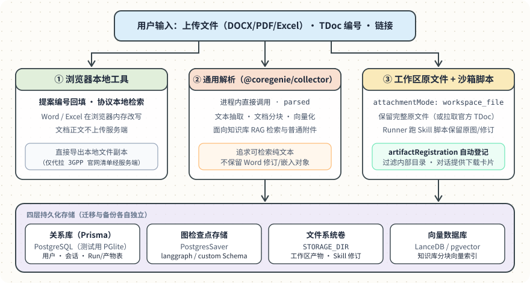

# 文档解析、产物与数据存储

> **所属层级**：L2 专题 · 数据与文档流视图 ｜ 返回 [架构总览](../architecture.md)
>
> **本文范围**：理清系统中容易混淆的两条文档处理路径，以「3GPP 提案转 Markdown」走一遍从输入到可下载产物的完整数据流，并说明关系库、检查点、文件存储与向量库各自保存什么数据。

## 1. 两条文档处理路径（以及本地工具边界）

CoreGenie 里存在多种“处理文档”的能力，排查“为什么图表丢了”或“为什么上传后搜不到”时，先定位数据走的是哪条路：

| 处理路径 | 执行位置 | 典型用途 | 数据保真度与特点 |
| --- | --- | --- | --- |
| **通用解析（`@coregenie/collector`）** | 主服务进程内模块 [collector/service.ts](../../../collector/service.ts)（`processDocument`、`parseDocument`、`processLinkDocument`） | 知识库文档入库、向量化检索、`attachmentMode: "parsed"` 的普通附件文本提取 | 目标是产出可检索纯文本与分块；不保证保留 Word 修订标记、复杂嵌套图或嵌入对象 |
| **工作区原文件 + 沙箱专用转换** | 主服务保留原文件，沙箱 Runner 运行 Skill 打包脚本（如 [threeGpp.js](../../../server/tools/threeGpp.js)） | 3GPP 提案转 Markdown、提案拆分、PPT 生成与逐页渲染审阅 | `attachmentMode: "workspace_file"` 保留原始 DOCX 及二进制部件；脚本保留原图、嵌入对象和修订信息 |
| **纯浏览器本地工具** | 前端 TypeScript 模块（[localTools/README.md](../../../frontend/src/utils/localTools/README.md)） | 提案编号回填（Word/Excel）、协议 PDF 本地检索 | 文档正文在浏览器内存处理，**不上传服务器**；仅获取 3GPP 官方会议清单时通过已登录服务端代拉目录 |

### 1.1 `@coregenie/collector` 到底做什么、为什么保留它

初次阅读代码时，很容易疑惑为什么除了沙箱脚本之外还有一套 `collector/` 模块。简言之，**大模型和向量库不能直接读取 `.pdf`、`.docx`、`.xlsx`、`.pptx` 或 HTML，只认纯文本**；`@coregenie/collector` 就是继承自 AnythingLLM 的通用纯文本抽取包：

- **不是从零自研的解析器**：底层直接调用社区成熟库（[collector/package.json](../../../collector/package.json) 中的 `pdf-parse`、`mammoth`、`node-xlsx`、`officeparser`、`html-to-text`、`turndown`、`tesseract.js`）。CoreGenie 在原版基础上裁剪了未使用的第三方数据源、音频转写与旧版 `langchain@0.1.36`。
- **已合并进主服务进程**：早期上游把它拆成独立 Express HTTP 服务；重构后已改为 pnpm workspace 内部包 `@coregenie/collector`（[collector/service.ts](../../../collector/service.ts)），主服务通过函数直接调用，省去本机 HTTP 转发、额外端口和双进程管理，同时仍把解析依赖隔离在 `collector/` 包中。
- **具体在哪些操作时触发**：
  1. 向工作区或公共知识库上传文档（`processDocument`）——抽出纯文本后交回主服务分块、算向量、写入向量库。
  2. 向知识库提交网页 URL 或定时刷新监控文档（`processLinkDocument`，见 [sync-watched-documents.js](../../../server/jobs/sync-watched-documents.js)）——抓网页并剥离 HTML 标签提取正文。
  3. 聊天框直接附带普通文档提问（`parseDocument`，见 [workspacesParsedFiles.js](../../../server/endpoints/workspacesParsedFiles.js)）——临时抽文本拼进当轮模型上下文。
  4. Agent 调用知识库入库工具（[tools/knowledge.js](../../../server/tools/knowledge.js)、[tools/globalKnowledge.js](../../../server/tools/globalKnowledge.js)）。
- **能力边界与扩展思路**：对于 3GPP 提案这类必须保留 Word 修订痕迹、嵌入 OLE/Visio 对象和原图位置的场景，通用纯文本抽取无法满足要求，因此单独走沙箱专用脚本。如果后续遇到双栏 PDF、复杂表格或扫描件入库质量不足，可保留 `collector/service.ts` 接口不变，仅将 `.pdf` 等特定分支委托给独立部署的专业解析服务（如 Docling）。

## 2. 端到端追踪：把一份 3GPP 提案转成 Markdown

用一个真实的高频场景，把「提交 → 固定流程 → 沙箱转换 → 产物登记 → 页面下载」整条数据链串起来：

1. **保留原始输入**：用户使用绑定了 `3gpp-review` 与 `3gpp-doc2md` 的转换助手（[3gpp-markdown.yaml](../../../agent-config/agents/3gpp-markdown.yaml)），上传一份 DOCX（或输入单个 TDoc 编号）。因为助手的 `attachmentMode` 为 `workspace_file`，原始文件直接落盘到工作区目录，不经 Collector 降维成纯文本。
2. **命中确定性分支**：`governed-agent` 控制器识别到 `runtimeConfig.workflow === "3gpp-markdown-conversion"` 且输入唯一，直接由代码激活 `3gpp-review` 并调用 `3gpp.convert-markdown`，避免自由规划带来的不确定步骤。
3. **定位或拉取文档**：[server/tools/threeGpp.js](../../../server/tools/threeGpp.js) 优先定位工作区上传文件；若输入是可识别的 TDoc 编号（如 `S2-xxxxxx`），服务端从 3GPP 官方目录拉取压缩包（单包上限 100 MiB）并解压到工作区。
4. **沙箱执行转换**：工具通过 Broker 启动一次性 Runner，只读挂载 `3gpp-review` 修订包、读写挂载工作区，执行 Skill 内的转换脚本，输出 Markdown、图片/嵌入对象目录、转换摘要（含图片数、嵌入对象数、警告）和打包压缩文件。
5. **产物自动登记**：任务收尾时，[artifactRegistration.js](../../../server/agent-system/artifactRegistration.js) 从三处收集潜在产物路径——**最终回复中的路径引用**、**带 `writeIntent` 的子任务摘要**、以及 **`agent_tool_executions` 中写类工具的执行结果**（`filesystem.write`、`bash`、`python`、`3gpp.download`、`3gpp.convert-markdown`）：
   - 自动过滤隐藏目录（`.*`）、资源附带目录（`*.assets`）及内部临时目录（`_meta`、`_tmp`、`tmp`）。
   - 校验路径合法性与磁盘存在性后，在 `agent_run_artifacts` 表登记为 `workspaceFile` 或 `workspaceDirectory`（目录下载时动态打包为 `.zip`）。
6. **写入消息与下载**：执行器将产物列表随最终答复写入 `workspace_chats` 并通过 `message.completed` 事件推给前端；前端通过文件服务接口提供下载与预览。

> **分层排障技巧**：「转换内容错了/漏图了」查沙箱脚本输出与转换摘要；「磁盘上明明生成了文件，但对话里没有下载卡片」查路径是否落入了被过滤的内部目录，以及 `agent_run_artifacts` 和 `message.completed` 中的 `outputs` 字段。

## 3. 持久化存储分层

系统的数据并非全部塞在一个数据库里，而是按访问特征分成四层，升级、备份与迁移时必须分别对待：

| 存储层 | 实现与位置 | 存放的核心数据 | 运维与迁移要点 |
| --- | --- | --- | --- |
| **关系数据库（Prisma）** | 单一 **PostgreSQL** Schema（[server/prisma/schema.prisma](../../../server/prisma/schema.prisma)）；单元测试使用嵌入式 **PGlite** | 用户/OAuth 会话（`users`、`oauth_sessions`）、工作区与对话（`workspaces`、`workspace_threads`、`workspace_chats`）、Agent 全套运行表（`agent_runs`、`agent_run_events`、`agent_run_tasks`、`agent_tool_executions`、`agent_run_artifacts`、`agent_run_commands`、`agent_run_evidence`）、预置与个人 Skill/Agent/快捷任务、定时任务与记忆 | `docker-entrypoint.sh` 启动时直接执行 `prisma generate`、`prisma migrate deploy` 与 `prisma db seed`；旧 SQLite 实例的历史迁移步骤见 [PostgreSQL 迁移](../../postgresql-migration.md) |
| **LangGraph 检查点存储** | [checkpointer.js](../../../server/agent-system/checkpointer.js)，使用 `PostgresSaver` | 图运行中的中间状态快照（分 `langgraph` 与 `langgraph_custom` 两套隔离 PG Schema） | 默认复用 `DATABASE_URL`，也可通过 `LANGGRAPH_CHECKPOINT_DATABASE_URL` 指向独立库；与业务表分 Schema 隔离，终态任务自动清理 |
| **文件系统存储（`STORAGE_DIR`）** | 宿主机持久化卷挂载到 `/app/server/storage` | 工作区文件与产物目录、上传附件、全局 Skill 不可变修订快照、文档解析缓存、沙箱 Broker 通信 Socket 与 Token | 容器必须显式挂载持久化卷；沙箱通过挂载子目录读写工作区文件，因此需要保持容器 UID（默认 1000）权限一致 |
| **向量数据库** | 精简后的可插拔 Provider（[vectorDbProviders/](../../../server/utils/vectorDbProviders)）：默认内置 **LanceDB**，可选 **pgvector** | 知识库文档分块的向量索引与元数据，用于 RAG 召回 | 与关系库解耦：默认 LanceDB 落盘在 `STORAGE_DIR` 中；启用 `pgvector` 时可复用 PostgreSQL 实例存储向量 |

## 4. 协作权限与数据可见性边界

在多用户模式下，数据访问按两级控制（见 [agentRuns.js](../../../server/endpoints/agentRuns.js)）：

- **工作区级权限**：用户先通过 `Workspace.accessForUser` 校验所属工作区权限（普通成员 / 管理者 / `public_readonly` 只读公共区）。
- **会话级隔离**：工作区默认会话（无 `thread_id`）仅对本人（及管理员/经理）可见；命名线程（`workspace_threads`）对所有可访问该工作区的成员可见，管理与发送控制命令（取消、确认输入等）则额外校验写权限与协作规则。

---

**上一篇**：[← 配置体系、Skill、工具与沙箱](config-skills-sandbox.md) ｜ **下一篇**：[部署拓扑、认证与网络边界 →](deployment-and-boundaries.md)
