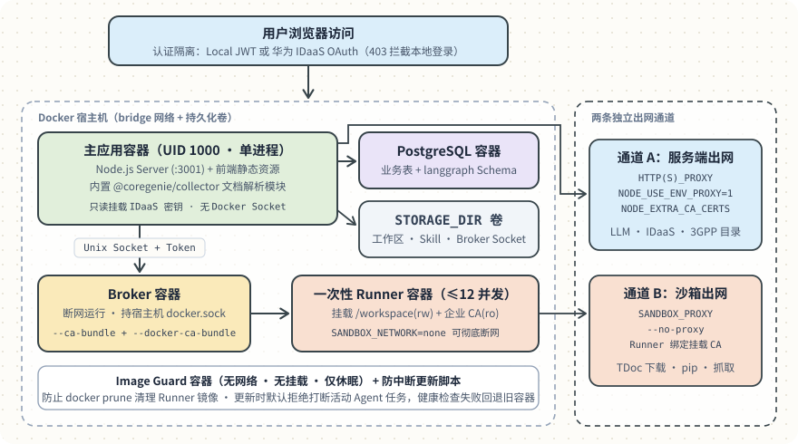

# 部署拓扑、认证与网络边界

> **所属层级**：L2 专题 · 部署与运行视图 ｜ 返回 [架构总览](../architecture.md)
>
> **本文范围**：说明 CoreGenie 在容器层的部署拓扑、进程启动方式、本地与 IDaaS 认证隔离机制，以及企业网络代理/CA 与灰度更新边界。具体安装命令与环境变量表直接查阅 [部署隔离说明](../../deployment-profiles.md) 和 [离线部署说明](../../offline-deployment.md)。

## 1. 容器部署拓扑

CoreGenie 同一套代码支持两种部署形态：

- **最小运行形态**：主应用容器（内置前端静态资源、Node.js Server 与进程内 `@coregenie/collector`）+ **PostgreSQL 容器**；适合试用或暂不启用代码执行沙箱的环境。
- **完整生产形态**：主应用容器 + PostgreSQL 容器 + 沙箱 Broker 容器 + 按需拉起的一次性 Runner 容器 + Image Guard 保护容器（由 `start-anythingllm.sh` 或 Compose 编排）。

### 主应用容器内的单进程启动模型

查看 [docker-entrypoint.sh](../../../docker/docker-entrypoint.sh) 可知，Collector 合并为进程内包后，主应用容器已简化为**单 Node.js 进程**：

1. 启动前置步骤：执行 `prisma generate`、`prisma migrate deploy` 与 `prisma db seed`（统一使用 `server/prisma/schema.prisma` 对接 PostgreSQL）。
2. 主进程接管：`exec node /app/server/index.js` 直接作为容器 PID 1 运行（同时托管 `server/public` 前端静态资源，并在 `/assets` 缺失旧哈希 chunk 时注入一次性刷新恢复脚本；进程内直接加载 `@coregenie/collector`）。

使用 `exec` 让 Node 进程直接接收宿主机与 Docker 发出的 `SIGTERM`/`SIGINT` 信号，进程退出即容器退出，行为简洁确定。

## 2. 认证模式隔离：Local vs IDaaS OAuth

同一镜像通过环境变量 `COREGENIE_AUTH_MODE` 在两套认证模式间切换，且**代码与镜像构建完全一致，只隔离运行时配置与密钥**：

| 维度 | 本地认证（`local`，默认） | 华为 IDaaS OAuth（`idaas`） |
| --- | --- | --- |
| 密钥配置 | 不读取 `COREGENIE_IDAAS_CONFIG_FILE` | 宿主机只读挂载安装专属 JSON 密钥文件（`clientId`、`clientSecret`、`environment`、`redirectUri`） |
| 路由策略（[idaas.js](../../../server/endpoints/idaas.js)） | 放行本地登录、注册、找回密码、邀请链接与原有 SSO | `oauthPolicy` 中间件在 API 入口直接以 **403** 拦截本地登录、注册、改密、找回密码与邀请注册接口 |
| 会话与用户表 | 使用 `users` 表签发 JWT | 新增可空字段与 `oauth_sessions` 表，不破坏原有本地用户与内容数据 |

排查登录问题时，可先检查 `GET /api/auth/config` 返回的 `provider` 字段确认当前生效模式。

## 3. 双通道网络边界：代理、私有 CA 与离线环境

在企业内网或受限出网环境中，最容易踩的坑是**只给主服务配了代理/证书，忘了给沙箱配**。架构上存在**两条独立的出网路径**：

| 出网主体 | 典型外部请求 | 网络配置方式 |
| --- | --- | --- |
| **主应用容器（Server）** | 上游 LLM API、IDaaS OAuth、3GPP 会议列表与官网文档、Web Search | 容器环境变量 `HTTP_PROXY` / `HTTPS_PROXY` / `NO_PROXY` + `NODE_USE_ENV_PROXY=1`；私有 CA 挂载文件并设 `NODE_EXTRA_CA_CERTS` |
| **沙箱 Runner 容器** | 3GPP 提案下载脚本、`pip install` / `uv`、外部网页抓取 | 由 Broker 在创建容器时注入 `SANDBOX_PROXY`、`--no-proxy` 及 `--ca-bundle` / `--docker-ca-bundle`（同时传递宿主机路径以便二次 bind-mount 到每个新 Runner）；设 `SANDBOX_NETWORK=none` 可彻底断网 |

> **关键约束**：Broker 容器本身始终处于断网模式；单独修改 Broker 环境变量不会让 Runner 信任企业私有 CA，必须同时提供 Broker 可读路径和宿主机绝对路径供 Runner 挂载。

## 4. 更新与发布机制的架构考量

因为 Agent 任务往往运行时间很长，容器发布流程专门针对**长任务保护**和**构建效率**做了两层设计：

1. **防中断部署与自动回滚**（[deploy-existing-container.cjs](../../../scripts/deploy-existing-container.cjs)）：
   - 更新主应用或 Broker 前，脚本默认检查是否有正在运行或排队的 Agent 任务，存在活动任务时拒绝中断（除非显式传入 `--allow-running`）。
   - 拉取新镜像后才停旧容器，自动继承原容器的挂载卷、网络、端口、代理与认证环境变量；新容器健康检查失败时自动切回旧容器（注意：容器回退不会回滚已执行的数据库迁移）。
2. **完整镜像 vs 前端轻量镜像**（[frontend-images.md](../../frontend-images.md)）：
   - 涉及服务端、数据库、Collector、Agent 配置或沙箱的改动走完整镜像发布。
   - 仅改前端样式、文案或页面交互时，可基于当前运行后端的固定 digest 构建**前端轻量镜像**（`<base_version>-ui.<commit>`），只叠加前端静态资源层并保留基础镜像中的旧哈希文件，降低已打开页面的静态资源失效率。

## 5. 关键配置与运维文档索引

- 本地与远端环境隔离、升级命令、IDaaS 挂载：[本地与远端部署隔离](../../deployment-profiles.md)
- SQLite 到 PostgreSQL 完整迁移步骤：[从 SQLite 切换到 PostgreSQL](../../postgresql-migration.md)
- 断网/内网离线打包与安装：[离线部署说明](../../offline-deployment.md)
- 并发数、超时与沙箱资源预算：[执行上限](../../execution-limits.md)
- 纯前端快速构建与发布约束：[前端轻量镜像](../../frontend-images.md)

---

**上一篇**：[← 文档解析、产物与数据存储](data-and-documents.md) ｜ **回到起点**：[架构总览](../architecture.md)
