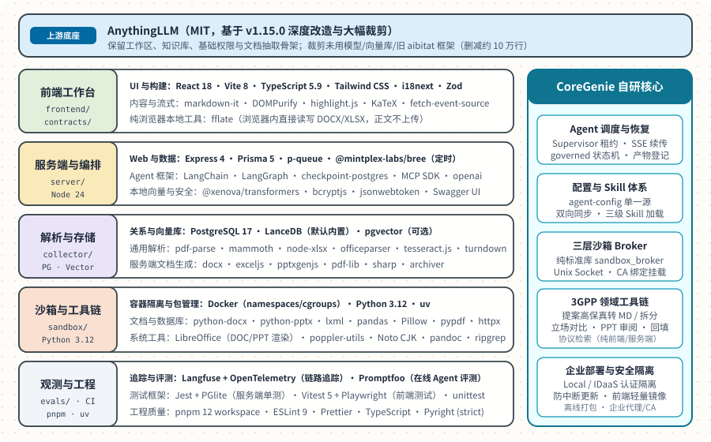

# 开源成分与技术栈清单

> **所属层级**：L2 专题 · 成分与依赖视图 ｜ 返回 [架构总览](../architecture.md)
>
> **本文范围**：说明 CoreGenie 基于哪些开源项目改造和组装、每个核心组件用在什么位置、解决什么问题，以及哪些部分属于 CoreGenie 自研。完整依赖版本以各子目录的 `package.json`、[sandbox/pyproject.toml](../../../sandbox/pyproject.toml) 与锁文件为准。

## 1. 上游底座：与 AnythingLLM 的继承与分界

CoreGenie 基于开源项目 **AnythingLLM（MIT，上游 `v1.15.0`）** 深度改造，并不是推倒重写的全自研应用，也不是简单换皮肤的套壳。两者边界如下：

| 类别 | 具体模块 | 说明 |
| --- | --- | --- |
| **保留并沿用** | 工作区与线程模型、基础用户/角色权限、RAG 向量检索骨架、通用文档纯文本解析库（`collector/`）、对外 Developer API 与 OpenAI 兼容接口 | 省去重复搭建基础多用户知识库平台的成本 |
| **大幅裁剪** | 移除旧 `aibitat` Agent 框架（约 2.2 万行）、未使用的 20+ 模型/向量库连接器、Telegram 机器人、浏览器扩展、嵌入挂件、Flow 工具链、音频转写与 8 张退役表 | 收敛维护面：LLM 收敛为 OpenAI 兼容网关，向量库收敛为 LanceDB / pgvector，数据库收敛为单一 PostgreSQL |
| **CoreGenie 自研** | 整套 `server/agent-system/` 异步调度与 LangGraph 运行时、`agent-config/` 单一配置源与双向同步、三级 Skill 体系、`sandbox/sandbox_broker/` 三层隔离沙箱、3GPP 领域脚本与纯浏览器本地工具、华为 IDaaS 认证隔离、防中断部署脚本 | 构成面向 3GPP 提案分析与长耗时 Agent 工作的核心能力 |

## 2. 前端工作台与共享契约（`frontend/` · `packages/contracts/`）

前端位于 [frontend/package.json](../../../frontend/package.json)，前后端共用类型契约位于 [packages/contracts/](../../../packages/contracts)：

| 开源项目 | 常见协议 | 用在什么地方 | 解决什么问题 |
| --- | --- | --- | --- |
| **React 18** + **React Router 6** | MIT | 整个前端单页应用 | 组件化界面与路由管理（含 `/help`、工作区对话、管理后台） |
| **Vite 8** + **TypeScript 5.9** | MIT / Apache-2.0 | 前端构建与严格类型检查 | 快速开发热更新、生产打包（含 `@help-docs` 静态文档与 SVG 打包） |
| **Tailwind CSS 3** + **Phosphor Icons** + **Headless UI** | MIT | 全站样式、暗色/亮色主题与无障碍弹窗/菜单 | 统一视觉变量和响应式布局 |
| **Zod 4** | MIT | `packages/contracts/` 与前后端接口校验 | 前后端共享运行时 Schema 与 TypeScript 类型 |
| **markdown-it** + **DOMPurify** + **highlight.js** + **KaTeX** | MIT / Apache-2.0 / BSD | 对话消息渲染、帮助页架构文档渲染 | 安全地将 Markdown、代码块和数学公式渲染为 HTML（防 XSS） |
| **@microsoft/fetch-event-source** | MIT | [agentSSETransport.ts](../../../frontend/src/utils/chat/agentSSETransport.ts) | 带鉴权请求头订阅 Agent SSE 事件流与断线重连 |
| **fflate** | MIT | [frontend/src/utils/localTools/](../../../frontend/src/utils/localTools/README.md) | 在浏览器内存里直接解压和重打包 `.docx` / `.xlsx`（OOXML），实现提案编号回填而不上传文档正文 |
| **i18next** + **react-i18next** | MIT | [frontend/src/locales/zh/common.ts](../../../frontend/src/locales/zh/common.ts) | 集中管理全站简体中文文案 |

## 3. 服务端与 Agent 运行时（`server/`）

服务端运行在 Node.js 24 上，依赖定义在 [server/package.json](../../../server/package.json)：

| 开源项目 | 常见协议 | 用在什么地方 | 解决什么问题 |
| --- | --- | --- | --- |
| **Express 4** + **Swagger UI** | MIT / Apache-2.0 | [server/index.js](../../../server/index.js) 与 `server/endpoints/` | HTTP API 路由、SSE 响应、静态前端托管及 `/api/docs` 开发者文档 |
| **Prisma 5** + **node-postgres (`pg`)** | Apache-2.0 / MIT | [server/prisma/schema.prisma](../../../server/prisma/schema.prisma) | PostgreSQL 数据建模、类型化查询与版本化数据库迁移 |
| **LangChain** + **@langchain/openai** | MIT | [server/agent-system/graph.js](../../../server/agent-system/graph.js) | 统一对接 OpenAI 兼容模型、组装工具 Schema 与消息中间件 |
| **LangGraph** + **checkpoint-postgres** | MIT | [governed.js](../../../server/agent-system/runtimes/governed.js)、[checkpointer.js](../../../server/agent-system/checkpointer.js) | 构建多阶段状态图（规划/并发/复查/汇总），并将图状态持久化到 PostgreSQL 支撑人工挂起与重启恢复 |
| **@modelcontextprotocol/sdk** + **@langchain/mcp-adapters** | MIT | [mcpServers.js](../../../server/endpoints/mcpServers.js) | 接入外部 MCP（Model Context Protocol）工具服务 |
| **p-queue** | MIT | [supervisor.js](../../../server/agent-system/supervisor.js) | 控制单进程内 Agent 任务并发上限（默认 8） |
| **@mintplex-labs/bree** + **cron-validate** | MIT | `server/jobs/` 与定时任务 | 定时执行后台文档同步和工作区定时任务 |
| **@xenova/transformers** + **js-tiktoken** | Apache-2.0 / MIT | 本地 Embedding 与上下文长度估算 | 无需外部 Embedding 服务即可本地算向量，并做上下文压缩预算计算 |
| **bcryptjs** + **jsonwebtoken** | MIT | 本地用户认证与会话签发 | 密码哈希与 JWT 鉴权（`COREGENIE_AUTH_MODE=local`） |

## 4. 文档解析与数据存储（`collector/` · PostgreSQL · 向量库）

| 开源项目 | 常见协议 | 用在什么地方 | 解决什么问题 |
| --- | --- | --- | --- |
| **PostgreSQL 17** | PostgreSQL License | 独立容器（[docker-compose.postgresql.yml](../../../docker/docker-compose.postgresql.yml)） | 统一承载全部业务表与 LangGraph 检查点 Schema |
| **LanceDB**（默认） / **pgvector**（可选） | Apache-2.0 / PostgreSQL | [server/utils/vectorDbProviders/](../../../server/utils/vectorDbProviders) | 知识库文档分块向量索引与相似度检索 |
| **pdf-parse** · **mammoth** · **node-xlsx** · **officeparser** · **epub2** | MIT / BSD / Apache-2.0 | 进程内包 [collector/package.json](../../../collector/package.json) | 把 PDF、Word、Excel、PPT、EPUB 抽成纯文本供 RAG 建索引 |
| **node-html-parser** · **html-to-text** · **turndown** · **cheerio** | MIT | `collector/` 与 `server/tools/` | 抓取并清洗网页 HTML、解析 3GPP 官网目录页 |
| **tesseract.js** + **sharp** | Apache-2.0 | `collector/` 图片 OCR 与图像处理 | 识别图片中的文字与常见图片格式处理 |
| **docx** · **exceljs** · **pptxgenjs** · **pdf-lib** · **archiver** · **adm-zip** | MIT | `server/services/` 与 `server/tools/` | 服务端生成/读取 Office 与 PDF 文件，以及目录产物打包 `.zip` |

## 5. 代码执行沙箱与文档工具链（`sandbox/`）

沙箱分成**极简 Broker**和**重型工具链 Runner**两个镜像，成分刻意拆开：

- **Broker 容器（[Dockerfile.broker](../../../sandbox/Dockerfile.broker)）**：仅包含 **Python 3.12（PSF）标准库** + **Docker CLI** 二进制，**零第三方 `pip` 依赖**，把持有 Docker Socket 的容器攻击面压到最小。
- **Runner 容器（[sandbox/Dockerfile](../../../sandbox/Dockerfile) 与 [sandbox/pyproject.toml](../../../sandbox/pyproject.toml)）**：
  - **容器隔离与包管理**：**Docker**（Linux namespaces + cgroups，Apache-2.0）、**uv**（Apache-2.0 / MIT，负责锁定与安装 Python 依赖，同时也供 Agent 运行 PEP 723 脚本）。
  - **Python 核心库**：`python-docx`、`python-pptx`、`lxml`、`pypdf`、`Pillow`、`openpyxl`、`XlsxWriter`、`pandas`、`numpy`、`requests` / `httpx` / `aiohttp`、`beautifulsoup4`、`PyYAML`、`pydantic`、`SQLAlchemy`、`tenacity`、`pytest`——支撑 3GPP 提案高保真转 Markdown、DOCX 拆分、PPT 生成与数据分析。
  - **系统级工具链**：**LibreOffice**（Writer / Impress / Draw，MPL-2.0，用于旧版 `.doc` 转档和 PPT 逐页渲染审阅）、**poppler-utils**（PDF 转图与文本检查）、**Noto CJK 字体**（OFL-1.1，保证中文 PDF/PPT 渲染不乱码）、**pandoc**、**ripgrep** / `fd` / `jq` / `yq` / `git` / `curl` / `sqlite3`。

## 6. 可观测、测试与工程基础设施

| 开源项目 | 常见协议 | 用在什么地方 | 解决什么问题 |
| --- | --- | --- | --- |
| **Langfuse** + **OpenTelemetry** | MIT / Apache-2.0 | [observability.js](../../../server/agent-system/observability.js) | 记录每次 Agent 运行的模型调用、工具耗时与链路 Trace |
| **Promptfoo** | MIT | [evals/agent/](../../../evals/agent/README.md) | 通过 `/api/v1` 对真实 Agent 运行时做自动化回归评测与人工对比打分 |
| **pnpm 12** | MIT | [pnpm-workspace.yaml](../../../pnpm-workspace.yaml) | 统一管理 `frontend`、`server`、`collector`、`packages/contracts` 多包依赖与锁文件 |
| **Jest 29** + **PGlite** | MIT / Apache-2.0 | `server/__tests__/` | 服务端单测，利用嵌入式 WASM PostgreSQL（PGlite）在不依赖外部数据库的情况下跑完整 Prisma 测试 |
| **Vitest 5** + **Playwright** | MIT / Apache-2.0 | `frontend/` 单测与端到端脚本 | 前端逻辑单测与无头 Chromium 界面回归验证 |
| **Pyright** + **ESLint 9** + **Prettier** | MIT | `sandbox/` 与全仓 lint | 沙箱 Python 严格静态类型检查与 JS/TS 代码规范检查 |

> **许可证边界说明**：CoreGenie 业务代码直接引入的 Node.js 与 Python 库以 **MIT / Apache-2.0 / BSD / PSF** 等宽松开源协议为主。沙箱 Runner 镜像中包含的 **LibreOffice（MPL-2.0）** 与 Linux 系统命令行工具（如 `bash`、`poppler-utils` 等 GPL/LGPL 工具）仅在一次性隔离容器内作为独立命令行进程调用，不与业务代码发生静态链接或代码合并。

---

**上一篇**：[← 部署拓扑、认证与网络边界](deployment-and-boundaries.md) ｜ **回到起点**：[架构总览](../architecture.md)
